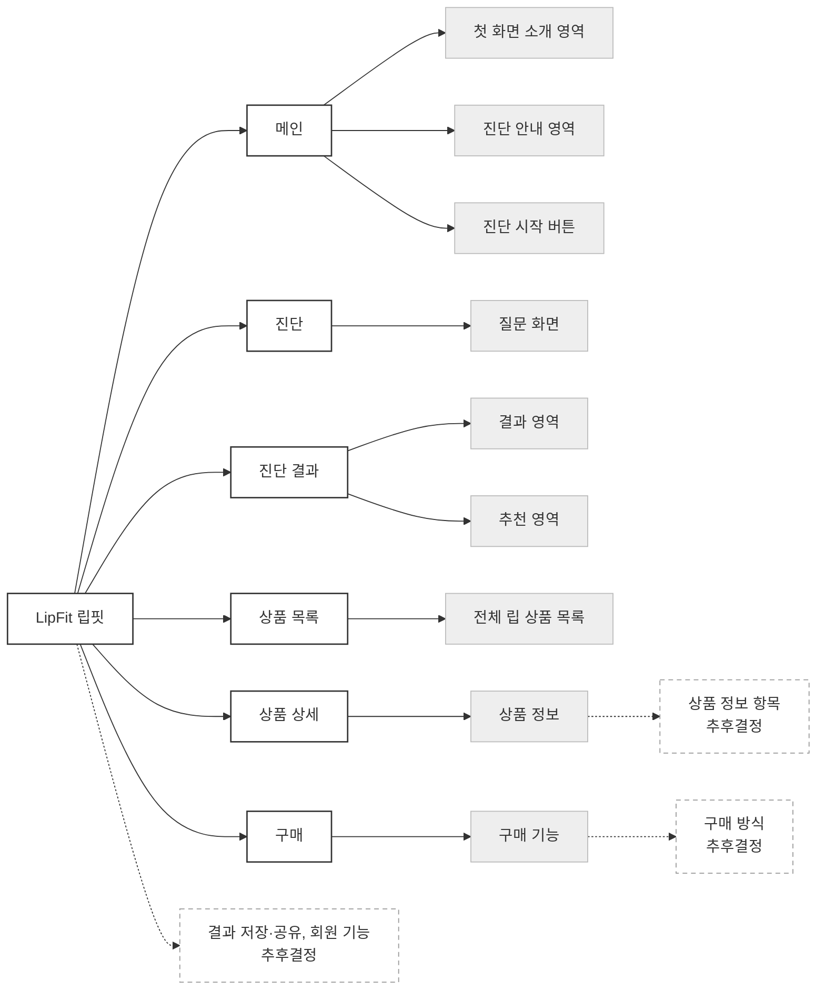

# 립핏(LipFit) 사이트맵

기준 문서: 01-site-purpose.md, 02-site-structure.md

## 1. 표기 기준

| 표기 | 의미 |
|---|---|
| 흰색 실선 박스 | 페이지 (확정) |
| 연회색 작은 박스 | 페이지 안의 섹션 (확정) |
| 점선 박스 + '추후결정' | 아직 정하지 않은 항목 |

## 2. 가로 계층도

## 3. 계층 목록

- **LipFit 립핏**
  - **메인**
    - 첫 화면 소개 영역
    - 진단 안내 영역
    - 진단 시작 버튼
  - **진단**
    - 질문 화면
  - **진단 결과**
    - 결과 영역
    - 추천 영역
  - **상품 목록**
    - 전체 립 상품 목록
  - **상품 상세**
    - 상품 정보
      - (점선) 상품 정보 항목 — 추후결정
  - **구매**
    - 구매 기능
      - (점선) 구매 방식 — 추후결정
  - (점선) 결과 저장·공유, 회원 기능 — 추후결정

## 4. 추후결정 항목 (02-site-structure.md 기준)

- 구매 방식
- 진단 질문 수와 질문 내용
- 결과로 나눌 톤 종류
- 결과 화면에 보여줄 추천 컬러 수
- 상품 수와 상품 상세에 들어갈 정보 항목
- 진단 시작 버튼을 메인 외 다른 페이지에도 둘지 여부
- 결과 저장·공유, 회원 기능 필요 여부

## 5. 확정한 선택 (02-site-structure.md 기준)

- 진단 결과는 진단(질문) 페이지와 나누어 별도 페이지로 구성

## 6. Figma

| 항목 | 내용 |
|---|---|
| 형식 | FigJam 보드 (연결된 계정에서 Figma 디자인 파일 편집이 막혀 FigJam으로 생성) |
| 다이어그램 이름 | LipFit 사이트맵 |
| 링크 | 확인 필요 (생성 도구가 링크를 돌려주지 않아, 보드를 연 뒤 링크를 받아 기입) |
| 상태 | 진단 결과 페이지 분리 결정 이전 버전 (다시 그려야 함) |

FigJam 표현 방식
- 페이지: 흰색 박스, 진한 테두리
- 섹션: 연회색 박스
- 미정 항목: 점선 연결선 + '추후결정:' 표시, 회색 테두리 (박스 테두리 자체를 점선으로 만드는 기능은 생성 도구에서 지원하지 않음)

참고: Figma 디자인 파일(lipfit, LipFit)에는 계정 조건(Starter 플랜, View 좌석)으로 쓰기 권한이 없어 그리지 못함
